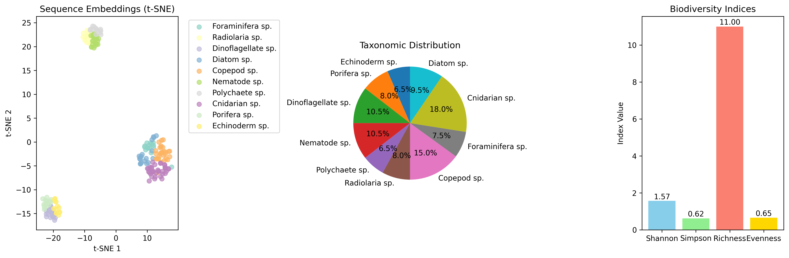

<div align="center">

# 🌊 SeaquenceAI

### AI-driven eDNA biodiversity analysis and an interactive dashboard

**Smart India Hackathon 2025 · team project**


</div>

---

## The problem

Environmental DNA (eDNA) lets researchers survey marine life from a water sample instead of catching or photographing organisms. But turning thousands of raw DNA reads into a list of taxa and a biodiversity estimate is slow, manual and needs specialist tools.

**SeaquenceAI** is a prototype pipeline and web dashboard that takes DNA sequences (FASTA), learns an embedding for each read, groups reads into taxa, flags clusters that do not match any known taxon as **potentially novel**, and reports standard biodiversity indices, all in one place.



<sub>Demo run on 500 synthetic sequences: t-SNE of learned embeddings (left), taxonomic distribution (centre), biodiversity indices (right).</sub>

---

## How it works

```
FASTA reads ──► integer encoding (A/C/G/T/N) ──► BiLSTM + multi-head attention encoder ──► 128-d embedding per read
                                                                                              │
                         ┌────────────────────────────────────────────────────────────────────┤
                         ▼                                                                    ▼
              K-Means assignment to                                                 DBSCAN on unassigned reads
              reference taxa                                                        → candidate novel clusters
                         │                                                                    │
                         └──────────────► Shannon · Simpson · richness · evenness ◄───────────┘
                                                        │
                                          Dash / Plotly dashboard + JSON report
```

| Stage | What it does | Code |
|---|---|---|
| **Load** | Reads FASTA with Biopython, or generates a synthetic demo set | `SeaquenceAI.load_sequences` |
| **Encode** | Maps A/C/G/T/N to integers, pads to 300 bp | `DNASequenceDataset` |
| **Embed** | 2-layer BiLSTM → 8-head self-attention → mean-pool → 128-d vector | `DNAEmbeddingModel` |
| **Classify** | Groups embeddings into reference taxa | `classify_sequences` |
| **Discover** | DBSCAN on unassigned reads to surface candidate novel taxa | `discover_novel_clusters` |
| **Measure** | Shannon diversity, Simpson diversity, species richness, Pielou evenness | `calculate_biodiversity_indices` |
| **Explore** | Upload FASTA, run analysis in the background, view interactive plots | `seaquence_plotly_app.py` |

---

## Demo results

From the bundled run on **500 synthetic sequences** (`results/demo_results.json`):

| Metric | Value |
|---|---|
| Sequences processed | 500 |
| Taxa observed (richness) | 11 |
| Shannon diversity | 1.57 |
| Simpson diversity | 0.62 |
| Evenness | 0.65 |
| Candidate novel clusters | 1 |

> These numbers come from simulated reads and show the pipeline working end to end. They are not a biological finding.

---

## Quick start

```bash
git clone https://github.com/ojaswi04/SeaquenceAI-eDNA-Biodiversity.git
cd SeaquenceAI-eDNA-Biodiversity
pip install -r requirements.txt
```

**Run the dashboard**

```bash
python seaquence_plotly_app.py
# open http://localhost:8050
```

Upload a `.fasta` file, or click **Demo with AI Dataset** to run on synthetic reads.

**Run the pipeline from Python**

```python
from seaquence_ai_main import SeaquenceAI

pipeline = SeaquenceAI()
results = pipeline.run_full_analysis(fasta_file="your_samples.fasta")  # omit for the demo set
```

This writes `seaquence_ai_results.json` and `seaquence_ai_results.png`.

---

## Repository layout

```
├── seaquence_ai_main.py        # core pipeline: encoder, classification, novelty, indices
├── seaquence_plotly_app.py     # Dash dashboard (FASTA upload, background analysis, plots)
├── seaquence_ai_plotly_og.py   # earlier version of the dashboard
├── test_import.py              # environment and import check
├── results/demo_results.json   # output of the demo run
├── assets/results_overview.png # figure shown above
└── requirements.txt
```

---

## Current limitations and next steps

This was built in a hackathon, so some parts are deliberately simplified:

- **Reference taxa are a 10-entry placeholder list.** Next: match against a real marker-gene database such as SILVA, PR2 or BOLD.
- **Taxon assignment uses K-Means on embeddings**, and per-read confidence is a placeholder. Next: a supervised classifier trained on labelled reference reads, with calibrated confidence.
- **The encoder trains for 5 epochs with a simple objective.** Next: contrastive or masked-sequence pre-training, or a pretrained DNA language model.
- **Validation:** benchmark on a public eDNA dataset with known community composition.

---

## Author

**Ojaswi Gondalia** · B.Tech Artificial Intelligence, NMIMS Mumbai  
[GitHub](https://github.com/ojaswi04) · [LinkedIn](https://linkedin.com/in/ojaswi-gondalia-25bb65205) · ojaswigondalia@gmail.com

Built with my team for **Smart India Hackathon 2025** (problem statement: *Identifying taxonomy and assessing biodiversity from eDNA datasets*).

## License

[GPL-3.0](LICENSE)
